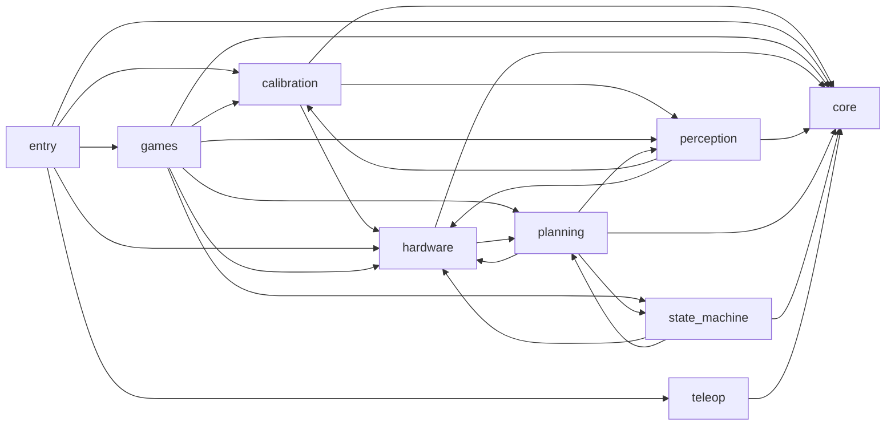

# Knowledge graph of the code

Generated by `python dev/tools/knowledge_graph.py` from the code itself; do not edit by hand (rebuild it
after changing files). Use it to find where something lives before searching. Per file: purpose,
what it defines, imports (project modules only, lazy imports included), who imports it, and the config
files it uses, directly or through core/arms.py, games/rules.py, ... (every path is in `core/paths.py`, all
YAML reading and writing in `core/config.py`). `dev/` is listed briefly: nothing outside `dev/` imports it.

## Package dependencies

(`entry` = the numbered scripts and run_game.py at the repository root.)

## Entry points

| command | runs | purpose |
|---|---|---|
| `python 01_setup_usb.py` | `hardware.usb_ports` | Step 1: detect the four arms' USB boards, record their IDs, and give each a fixed name with a udev rule. |
| `python 02_calibrate.py` | `calibration.calibrate`, `calibration.lerobot_sync`, `core.arms`, `hardware.joint_offsets` | Step 2: calibrate the arms and the camera. |
| `python 03_teleop.py` | `teleop.teleop`, `teleop.teleop_net` | Step 3: teleoperate each follower with its leader (the pairs and ports come from config/arms.yaml). |
| `python run_game.py` | `games` | Step 4: play a game. |

## Config files and the modules that use them

- `config/arms.yaml`: `02_calibrate`, `calibration.calibrate`, `calibration.lerobot_sync`, `core.arms`, `games.pick_and_place`, `hardware.arm`, `hardware.usb_ports`, `planning.ik`, `planning.pick_planner`, `planning.sim`, `state_machine.arm_worker`, `teleop.teleop`, `teleop.teleop_gui`, `teleop.teleop_net`
- `config/perception.yaml`: `calibration.calibrate`, `perception.colour`, `perception.detection`, `perception.live`, `perception.silhouette_live`
- `config/teleop.yaml`: `03_teleop`, `teleop.teleop_net`
- `config/games/<game>.yaml`: `games.pick_and_place`, `games.rules`, `games.two_arm_coordination`
- `config/calibration/camera.yaml`: `02_calibrate`, `calibration.calibrate`, `perception.detection`
- `config/calibration/camera_transform.npy`: `calibration.calibrate`, `perception.detection`, `perception.live`, `perception.silhouette_live`
- `config/calibration/<arm>/motors.yaml`: `02_calibrate`, `calibration.lerobot_sync`, `core.arms`, `hardware.arm`, `planning.ik`
- `config/calibration/<arm>/joint_offsets.yaml`: `02_calibrate`, `calibration.calibrate`, `hardware.arm`, `hardware.joint_offsets`, `planning.ik`
- `config/calibration/colours.yaml`: `games.pick_and_place`, `perception.colour`

## Modules

### core/

**`core/arms.py`**: The arms' setup from config/arms.yaml: ports, USB serials, teleop pairs, where each follower stands, home pose.
- defines: load(), load_copy(), save(), followers(), leaders(), names(), entry(), role(), port(), base(), default_arm(), lerobot_type(), lerobot_calibration_dir(), lerobot_calibration(), follower_calibration(), calibration_file(), handoff_points(), handoff_min_spacing(), middle_half_width(), teleop_pairs(), bases(), arm_from_table()
- imports: core.config, core.paths
- used by: 02_calibrate, calibration.calibrate, calibration.lerobot_sync, games.pick_and_place, hardware.arm, hardware.usb_ports, planning.ik, planning.pick_planner, planning.sim, state_machine.arm_worker, teleop.teleop, teleop.teleop_gui, teleop.teleop_net (+6 in dev/)
- config: config/arms.yaml, config/calibration/<arm>/motors.yaml (also saves files)

**`core/config.py`**: Read and write the YAML files in config/.
- defines: class ConfigError, load(), load_copy(), header(), dump(), save()
- used by: calibration.calibrate, calibration.lerobot_sync, core.arms, games.rules, hardware.joint_offsets, perception.colour, perception.detection, planning.ik, teleop.teleop_net (+1 in dev/)

**`core/paths.py`**: Every fixed path in the project, in one place.
- defines: arm_calibration_dir()
- used by: calibration.calibrate, core.arms, games.rules, hardware.gripper, hardware.joint_offsets, perception.colour, perception.detection, planning.sim, teleop.teleop_net (+1 in dev/)

### hardware/

**`hardware/arm.py`** (runnable): The follower arms: connect (LeRobot SOFollower), read and send joints, follow paths, home and park; plus an end-effector controller (PyBullet IK -> the real arm).
- defines: arm_files(), robot_arm(), calib_limits_deg(), class EEController, connect_robot(), go_home(), park_pose(), on_every_arm(), park_and_disconnect(), read_joints_rad(), send_joints(), add_motion_args(), apply_motion_args(), motion_profile(), follow_path(), planning_start(), report_start(), move_to(), main()
- imports: core.arms, hardware.joint_offsets, planning.ik, planning.rrt_connect
- used by: calibration.calibrate, games.pick_and_place, state_machine.arm_worker (+7 in dev/)
- config: config/arms.yaml, config/calibration/<arm>/motors.yaml, config/calibration/<arm>/joint_offsets.yaml

**`hardware/gripper.py`** (runnable): The gripper: how far to open it for an object (its width from the STL, the jaw gap from the robot model), and closing it on an object with motor-current feedback.
- defines: jaw_table(), tip_below_grasp(), fixed_face_point(), held_point(), opening_width(), open_command(), object_height(), object_footprint(), object_top_face(), object_width(), read_gripper_current_ma(), close_gripper_with_current_feedback(), main()
- imports: core.paths
- used by: calibration.calibrate, games.pick_and_place, perception.live, planning.pick_planner, state_machine.arm_worker (+4 in dev/)

**`hardware/joint_offsets.py`**: Fine joint offsets of the SO-101 followers: software corrections on top of LeRobot's motor calibration.
- defines: own_offsets_file(), offsets_file(), load_fine_joint_offsets(), save_fine_joint_offsets(), correct_joint_position_deg(), motor_position_deg(), corrected_observation(), motor_action_from_corrected(), corrected_to_motor_radians(), offsets_radians()
- imports: core.config, core.paths
- used by: 02_calibrate, calibration.calibrate, hardware.arm, planning.ik (+1 in dev/)
- config: config/calibration/<arm>/joint_offsets.yaml (also saves files)

**`hardware/usb_ports.py`** (runnable): Step 1: find the four arms' USB boards and give each a fixed name, so a replug (which can change /dev/ttyACM0, 1, 2 ...) never breaks anything.
- defines: serial_devices(), key(), wait_for(), identify(), rule_lines(), install_rule(), saved_ids(), save_to_config(), list_devices(), check(), main()
- imports: core.arms
- used by: 01_setup_usb
- config: config/arms.yaml (also saves files)

### calibration/

**`calibration/calibrate.py`** (runnable): Camera and arm-placement calibration, and the fine joint offsets.
- defines: load(), save(), update(), arms(), default_arm(), arm_from_table(), camera_to_table(), camera_to_base(), lerobot_calibration(), joint_offsets(), fit_plane(), rotation_to_z(), fit_camera(), table_points(), find_markers(), marker_centres(), stamp(), open_zed(), grab(), plane_of(), draw(), aruco(), need_so101ik(), arm(), ids(), tape_model(), fit_tape(), project_table_points(), tape_verdict(), width_hint(), draw_tape_view(), save_tape_calibration(), tape_live(), tape(), fingertip_in_gripper_link(), class FingertipModel, fit_base(), touch_points(), touch(), show(), check(), class LiveObjects, draw_axes(), reference_marks(), working_area(), store_base(), offsets(), main()
- imports: core.arms, core.config, core.paths, hardware.arm, hardware.gripper, hardware.joint_offsets, perception.detection, perception.live, perception.silhouette_live
- used by: 02_calibrate, games.pick_and_place, perception.detection (+5 in dev/)
- config: config/arms.yaml, config/perception.yaml, config/calibration/camera.yaml, config/calibration/camera_transform.npy, config/calibration/<arm>/joint_offsets.yaml (also saves files)

**`calibration/lerobot_sync.py`** (runnable): Copy each arm's LeRobot motor calibration between LeRobot's own folder and the repo.
- defines: lerobot_file(), read_lerobot(), read_copy(), status(), pull(), push(), main()
- imports: core.arms, core.config
- used by: 02_calibrate
- config: config/arms.yaml, config/calibration/<arm>/motors.yaml (also saves files)

### teleop/

**`teleop/teleop.py`** (runnable): Teleoperate the followers with their leader arms; the pairs and ports come from config/arms.yaml.
- defines: command(), clean_environment(), open_terminal(), run_here(), main()
- imports: core.arms, teleop.teleop_gui
- used by: 03_teleop
- config: config/arms.yaml

**`teleop/teleop_gui.py`** (runnable): Teleoperate with live telemetry: every follower joint's angle, current, load and temperature, plotted while you drive the arms with their leaders.
- defines: signed(), lerobot_device(), class Pair, drive(), build_window(), refresh(), run(), add_args(), main()
- imports: core.arms
- used by: teleop.teleop, teleop.teleop_net
- config: config/arms.yaml

**`teleop/teleop_net.py`** (runnable): Teleop over the network: the leaders on one computer (send), the followers on another (receive).
- defines: settings(), connect(), disconnect(), send(), limit_step(), class Receiver, receive(), main()
- imports: core.arms, core.config, core.paths, teleop.teleop_gui
- used by: 03_teleop
- config: config/arms.yaml, config/teleop.yaml

### perception/

**`perception/cases.py`**: Load point-cloud cases saved by dev/experiments/capture_pointcloud_case.py.
- defines: find_cases(), to_table(), fit_plane(), class CaseObject, class Case, load_case()
- used by: perception.silhouette, perception.silhouette_live, perception.top_face (+3 in dev/)

**`perception/colour.py`** (runnable): Predict the colour (red / green / blue / yellow) of every labelled object from its HSV values.
- defines: load_colors(), to_hsv(), parse_labels(), object_pixels(), hue_dist(), classify(), circular_mean(), overlap_mask(), predict_image(), draw(), calibrate(), main()
- imports: core.config, core.paths, perception.white_balance
- used by: games.pick_and_place (+1 in dev/)
- config: config/perception.yaml, config/calibration/colours.yaml (also saves files)

**`perception/detection.py`**: YOLO + ZED helpers shared by every script: ROI, camera calibration, weights, point-cloud object centres and the top-face silhouette fit.
- defines: settings(), load_roi(), latest_weights(), roi_for_frame(), load_camera_transform(), transform_point(), camera_intrinsics(), top_face_fits(), visible_surface_center()
- imports: calibration.calibrate, core.config, core.paths, perception.object_models, perception.silhouette, perception.silhouette_live
- used by: calibration.calibrate, games.pick_and_place, perception.live, perception.silhouette_live, planning.pick_planner (+5 in dev/)
- config: config/perception.yaml, config/calibration/camera.yaml, config/calibration/camera_transform.npy (also saves files)

**`perception/live.py`**: ZED + YOLO + top-face silhouette detection of table objects, shared by the live viewer and the pipeline.
- defines: add_vision_args(), inside_bins(), rect_center(), class CentreSmoother, resample_outline(), parallax_center(), rendered_area(), parallax_with_size(), bin_center_from_pixels(), class Vision
- imports: hardware.gripper, perception.detection, perception.silhouette, perception.silhouette_live
- used by: calibration.calibrate, games.pick_and_place, perception.silhouette_live (+3 in dev/)
- config: config/perception.yaml, config/calibration/camera_transform.npy

**`perception/matching.py`**: Fit the STL model clouds to a segmented ZED point cloud with ICP.
- defines: rot_z(), class Pose, class FitResult, visible_mask(), class Matcher
- used by: perception.silhouette (+3 in dev/)

**`perception/object_models.py`** (runnable): Model point clouds from the competition STL files.
- defines: read_stl(), stable_poses(), sample_surface(), class ModelCandidate, top_face(), symmetry_order(), load_candidates(), candidates_for_class()
- used by: perception.detection, perception.silhouette, perception.silhouette_live, perception.top_face (+3 in dev/)

**`perception/silhouette.py`** (runnable): Render-and-compare: fit the STL to the YOLO mask by simulating the camera.
- defines: class Camera, class SilhouetteFit, class SilhouetteMatcher, fit_object(), crop_tile(), grid(), label(), main()
- imports: perception.cases, perception.matching, perception.object_models, perception.top_face
- used by: perception.detection, perception.live, perception.silhouette_live (+1 in dev/)

**`perception/silhouette_live.py`** (runnable): Real-time render-and-compare: YOLO masks -> STL silhouette fit -> top-face centres.
- defines: class Detection, local_table_z(), intrinsics_from_cloud(), class Track, class LiveFitter, class ReplaySource, class ZedYoloSource, draw(), save(), main()
- imports: perception.cases, perception.detection, perception.live, perception.object_models, perception.silhouette, perception.top_face
- used by: calibration.calibrate, perception.detection, perception.live
- config: config/perception.yaml, config/calibration/camera_transform.npy (also saves files)

**`perception/top_face.py`** (runnable): Top-face matching: find the object's top face in the point cloud, compare it with the STL top faces, and mark the orientation and centre.
- defines: class TopFaceResult, top_points(), snap_to_height(), rasterise_points(), rasterise_polygon(), template_points(), match_candidate(), fit_top_face(), estimate_intrinsics(), project(), render_centres_only(), main()
- imports: perception.cases, perception.object_models
- used by: perception.silhouette, perception.silhouette_live (+1 in dev/)

**`perception/white_balance.py`** (runnable): Optional white balance for perception/colour.py, turned on with --white-balance.
- defines: white_reference(), white_balance(), main()
- used by: perception.colour (+1 in dev/)

### planning/

**`planning/ik.py`**: Modified Fully Resampled PSO inverse kinematics using PyBullet.
- defines: read_motor_calibration(), class IKResult, load_robot_for_collision(), find_link_index(), class ModifiedFRPSOIK
- imports: core.arms, core.config, hardware.joint_offsets
- used by: hardware.arm, planning.rrt_connect, planning.sim
- config: config/arms.yaml, config/calibration/<arm>/motors.yaml, config/calibration/<arm>/joint_offsets.yaml

**`planning/pick_planner.py`**: Planning a pick and place for one arm: every waypoint's pose (M-FRPSO IK) and the collision-free path to it (RRT-Connect), in the planning world of planning/sim.py (the table, the bins, the other o...
- defines: plan_sequence(), add_obstacle(), add_other_arm(), handoff_checker(), grasp_height(), grasp_heights(), postures_for(), miss_position(), plan_task()
- imports: core.arms, hardware.gripper, perception.detection, planning.sim, state_machine.coordinator
- used by: games.pick_and_place, state_machine.arm_worker (+1 in dev/)
- config: config/arms.yaml

**`planning/rrt_connect.py`**: Joint-space RRT-Connect using ModifiedFRPSOIK collision validation.
- defines: class RRTConnectResult, class RRTConnectPlanner
- imports: planning.ik
- used by: hardware.arm, planning.sim

**`planning/sim.py`** (runnable): Simulation only: table + objects in PyBullet, then M-FRPSO IK and RRT-Connect, one step at a time.
- defines: add_table(), add_object(), tilt_down(), matrix_to_quaternion(), class World, wait(), main()
- imports: core.arms, core.paths, planning.ik, planning.rrt_connect
- used by: planning.pick_planner (+4 in dev/)
- config: config/arms.yaml

### state_machine/

**`state_machine/arm_worker.py`**: The state machine of one arm: task after task from the coordinator, each attempt a behaviour tree (locate the object and its bin, plan, grasp or back off, carry, release, home, verify the drop).
- defines: short(), follow(), go_home(), task_tree(), class TaskActions, arm_worker()
- imports: core.arms, hardware.arm, hardware.gripper, planning.pick_planner, state_machine.behaviour, state_machine.coordinator
- used by: games.pick_and_place (+1 in dev/)
- config: config/arms.yaml

**`state_machine/behaviour.py`**: A small behaviour tree: Sequence, Fallback and Action nodes, run (ticked) to the end in one call.
- defines: class Node, class Action, class Fail, class Sequence, class Fallback
- used by: state_machine.arm_worker

**`state_machine/coordinator.py`**: Two-arm task coordination: which arm does what, handoffs through the middle, and who may be where.
- defines: class Task, class Regions, reach(), drop_point(), box_reach(), why_skipped(), handoff_area(), build_tasks(), class Coordinator
- used by: games.pick_and_place, planning.pick_planner, state_machine.arm_worker (+1 in dev/)

### games/

**`games/__init__.py`**: The competition games: one script per game, built from the shared parts (perception/, planning/, state_machine/, hardware/) and its rules in config/games/<game>.yaml.
- used by: run_game

**`games/pick_and_place.py`** (runnable): Game 1, pick and place: the live view of every object and bin, Enter, and the arms sort them straight away.
- defines: colour_of(), object_stl(), same_size(), detect(), bin_for(), class TableView, put(), main()
- imports: calibration.calibrate, core.arms, games.rules, hardware.arm, hardware.gripper, perception.colour, perception.detection, perception.live, planning.pick_planner, state_machine.arm_worker, state_machine.coordinator
- config: config/arms.yaml, config/games/<game>.yaml, config/calibration/colours.yaml

**`games/rules.py`**: Game definitions: each game's rules are in config/games/<game>.yaml.
- defines: file(), available(), load(), modes(), default_mode(), mode(), bin_colour(), describe()
- imports: core.config, core.paths
- used by: games.pick_and_place, games.two_arm_coordination
- config: config/games/<game>.yaml

**`games/two_arm_coordination.py`** (runnable): Game 2, two-arm coordination: both arms together on multi-step tasks (rules section 5.8, GAME 2).
- defines: main()
- imports: games.rules
- config: config/games/<game>.yaml

### Entry points (repository root)

**`01_setup_usb.py`** (runnable): Step 1: detect the four arms' USB boards, record their IDs, and give each a fixed name with a udev rule.
- imports: hardware.usb_ports

**`02_calibrate.py`** (runnable): Step 2: calibrate the arms and the camera.
- defines: motors(), offsets(), camera(), sync(), status(), import_old(), main()
- imports: calibration.calibrate, calibration.lerobot_sync, core.arms, hardware.joint_offsets
- config: config/arms.yaml, config/calibration/camera.yaml, config/calibration/<arm>/motors.yaml, config/calibration/<arm>/joint_offsets.yaml

**`03_teleop.py`** (runnable): Step 3: teleoperate each follower with its leader (the pairs and ports come from config/arms.yaml).
- defines: main()
- imports: teleop.teleop, teleop.teleop_net
- config: config/teleop.yaml

**`run_game.py`** (runnable): Step 4: play a game.
- defines: main()
- imports: games

### dev/ (experiments and tools)

- `dev/calibration/fine_joint_calibration_gui.py`: Fine-tune SO-101 software joint offsets while hand-guiding the arm. Uses: hardware.arm, hardware.joint_offsets.
- `dev/calibration/gripper_current_gui.py`: Live graph of the SO-101 gripper's current, load and position. Uses: core.arms.
- `dev/dataset_tools/yolo_dataset/color_flow_viewer.py`: Step-by-step viewer for block_color.py: click through how every block's colour is decided. Uses: perception.colour, perception.white_balance.
- `dev/dataset_tools/yolo_dataset/dataset_generation.py`: Capture images from one ZED camera for YOLO training.
- `dev/dataset_tools/yolo_dataset/dataset_segmentation.py`: Semi-automatic YOLO segmentation labels using SAM point prompts.
- `dev/dataset_tools/yolo_dataset/labelstudio_convert.py`: Convert between YOLO segmentation labels and Label Studio (polygon) JSON.
- `dev/dataset_tools/yolo_dataset/live_seg.py`: Real-time YOLO segmentation on a ZED camera, using the ROI and the latest trained model.
- `dev/dataset_tools/yolo_dataset/predict_seg.py`: Segment every image in a folder using the ROI crop and the trained model.
- `dev/dataset_tools/yolo_dataset/prepare_dataset.py`: Split yolo_dataset into train/val and write data.yaml for YOLO segmentation.
- `dev/dataset_tools/yolo_dataset/roi.py`: Region of interest (ROI) shared by capture, training and inference. Uses: core.config, core.paths.
- `dev/dataset_tools/yolo_dataset/segview.py`: Browse images and inspect the YOLO segmentation, toggling each class on/off.
- `dev/dataset_tools/yolo_dataset/train_seg.py`: Prepare the ROI dataset and train YOLO segmentation at the ROI's native resolution.
- `dev/dataset_tools/yolo_dataset/view_labels.py`: View YOLO segmentation labels over the images.
- `dev/dataset_tools/yolo_pouring/pouring_dataset.py`: Bowl and cup (Game 2, pouring): collect pictures, label them, train and try a YOLO segmentation model.
- `dev/experiments/Full_pipeline.py`: Camera -> M-FRPSO pose -> RRT-Connect path -> real arm. Uses: core.arms, hardware.arm, hardware.gripper, perception.detection, perception.live, planning.sim.
- `dev/experiments/capture_pointcloud_case.py`: Capture one ZED frame, YOLO predictions, and per-object point-cloud samples. Uses: perception.detection.
- `dev/experiments/click_pick_place.py`: Pick and place with clicked positions instead of YOLO: mark the shapes and the boxes in the camera image, then the arms pick every shape and drop it into the box of its colour. Uses: calibration.calibrate, core.arms, hardware.arm, hardware.gripper, perception.detection, planning.pick_planner, planning.sim, state_machine.arm_worker, state_machine.coordinator.
- `dev/experiments/click_to_go.py`: Click a point in the ZED image; an arm's tip goes there. Uses: calibration.calibrate, core.arms, hardware.arm.
- `dev/experiments/go_to_point.py`: Send an arm's grasp point to an x y z, with the SAME planner pick and place uses. Uses: calibration.calibrate, core.arms, hardware.arm, planning.sim.
- `dev/experiments/match_gui.py`: GUI: compare STL model point clouds with the YOLO-segmented ZED point cloud (ICP). Uses: perception.cases, perception.matching, perception.object_models.
- `dev/experiments/object_3d_live.py`: Show YOLO objects with calibrated 3D centers from the YOLO mask and ZED point cloud. Uses: calibration.calibrate, core.arms, hardware.arm, hardware.gripper, perception.detection, perception.live, planning.sim.
- `dev/experiments/pointcloud_view.py`: Live ZED point cloud, seen from above and from the side, with every detection and its centre. Uses: calibration.calibrate, hardware.gripper, perception.detection, perception.live.
- `dev/experiments/render_centres.py`: Draw the fitted model centres back onto the camera image, to check them by eye. Uses: perception.cases, perception.matching, perception.object_models.
- `dev/experiments/set_so101_joint_positions.py`: Read and optionally set selected SO-101 arm joints in degrees. Uses: hardware.arm.
- `dev/experiments/silhouette_gui.py`: GUI: see how render-and-compare finds each object's top-face centre. Uses: perception.cases, perception.matching, perception.object_models, perception.silhouette, perception.top_face.
- `dev/tools/extract_3mf.py`: Extract every object in a 3MF project (e.g. a PrusaSlicer plate) into separate binary STL files.
- `dev/tools/knowledge_graph.py`: Build docs/knowledge_graph.md: a map of the code for people and for Claude, so nobody has to search for files.
